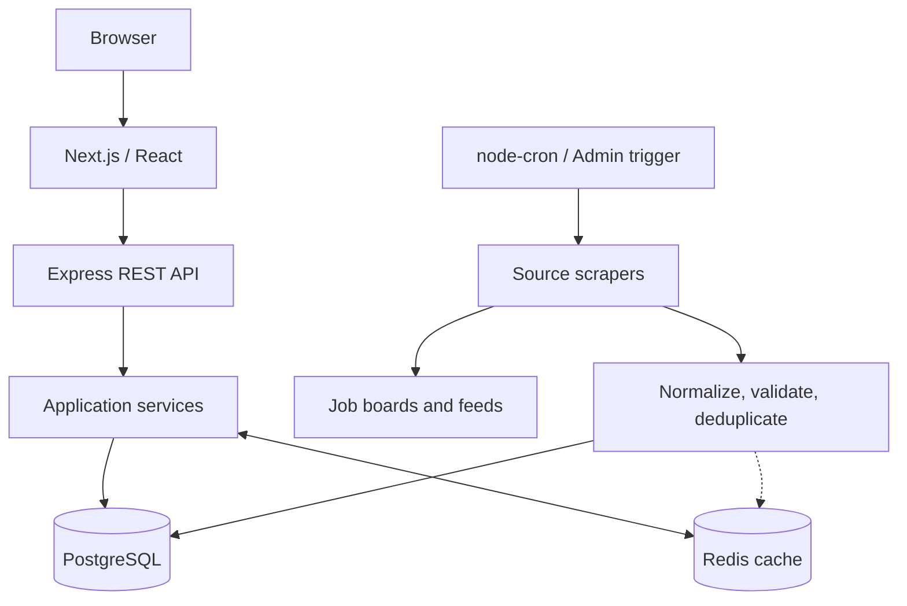

# JobLens

**JobLens aggregates remote job listings from multiple sources into one searchable platform, using a pipeline to normalize, validate, deduplicate, and store listings.**

**Live demo:** [JobLens](https://job-lens-gules.vercel.app/)


## Features

- Aggregate listings from multiple job boards, APIs, and feeds.
- Search job listings and view job details.
- Normalize, validate, and deduplicate job records.
- User accounts and saved jobs.
- Job statistics and Redis caching.
- Admin endpoints for manual scraping and operations.

## Architecture



## Technology stack

| Layer | Technologies |
|---|---|
| Frontend | Next.js, React, TypeScript, Tailwind CSS |
| API | Node.js, Express, TypeScript |
| Authentication | NextAuth, JWT, bcryptjs |
| Database | PostgreSQL, Prisma, `pg` |
| Cache | Redis, `ioredis` |
| Ingestion | Puppeteer, Cheerio, HTTP APIs / RSS |
| Scheduling and testing | node-cron, Vitest, Supertest |
| Deployment | Docker, Docker Compose |

## Data ingestion

1. Scrapers fetch listings from enabled sources.
2. A shared processor maps data to a common format, normalizes fields, validates records, and enriches descriptions when needed.
3. Deduplication keys are generated and accepted records are saved to PostgreSQL.
4. Related cache entries are invalidated after writes.

Scraping runs daily at 02:00 in the process's local timezone and can also be triggered by an administrator.

## Database and deduplication

PostgreSQL stores `Job`, `User`, `SavedJob`, and `ScrapeLog` records. Jobs use normalized `companyKey`, `positionKey`, and `locationKey` values for identity, enforced by a composite unique constraint:

```prisma
@@unique([companyKey, positionKey, locationKey])
```

This is deterministic matching, not fuzzy deduplication.

## Caching

Redis uses cache-aside reads:

- Job lists: **5 minutes**
- Job details: **10 minutes**
- Statistics: **30 minutes**

PostgreSQL remains the source of truth.

## Tests

From `api/`:

```bash
npm ci
npm test
npm run test:coverage
npm run build
```

From `frontend/`:

```bash
npm ci
npm run type-check
npm run build
```

## Local setup

**Requirements:** Node.js 20+, npm, PostgreSQL, and Redis.

1. Clone the repository:
   ```bash
   git clone https://github.com/Ayesha-Islam/Job-scraper.git
   cd Job-scraper
   ```
2. Copy `api/.env.example` to `api/.env` and configure the database, Redis, JWT, admin, and frontend-origin variables.
3. Copy `frontend/.env.example` to `frontend/.env.local` and configure the API URL and NextAuth secret.
4. Install dependencies and prepare the database:
   ```bash
   cd api
   npm ci
   npm run prisma:generate
   npm run prisma:migrate
   ```
5. Start the API with `npm run dev`. In another terminal, run `npm run dev` from `frontend/`.

Docker Compose builds the API and frontend, but PostgreSQL and Redis must be provided separately.

## Limitations and future improvements

**Current limitations:** external source changes can break scrapers; scraping is sequential; scheduling is process-local; deduplication is not fuzzy; Redis invalidation uses `KEYS`; search scalability is unverified.

**Future improvements:** durable queue workers, distributed scheduling, scalable cache invalidation, full-text search, rate limiting, stronger account security, and ingestion monitoring.

## Further documentation

See [`docs/`](docs/) for project documentation and [`api/prisma/schema.prisma`](api/prisma/schema.prisma) for database models.
